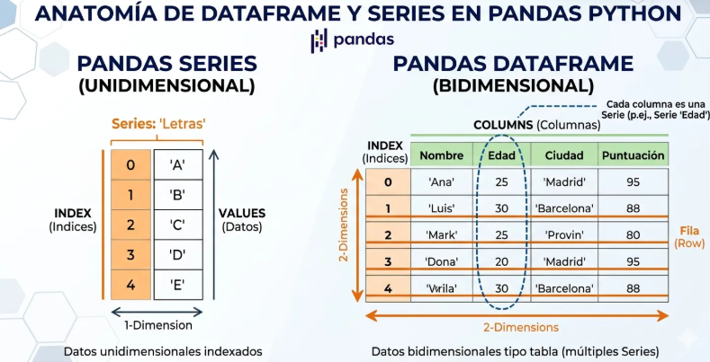
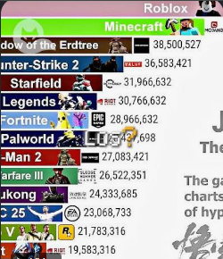
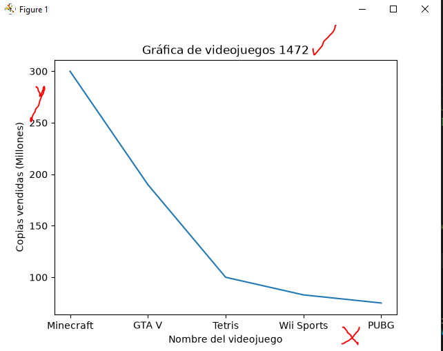
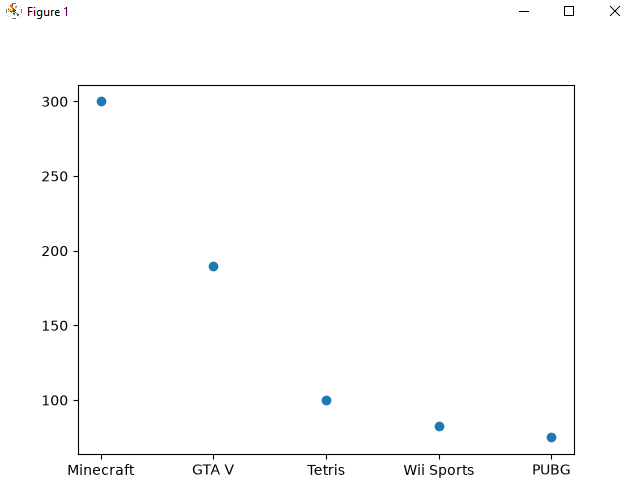
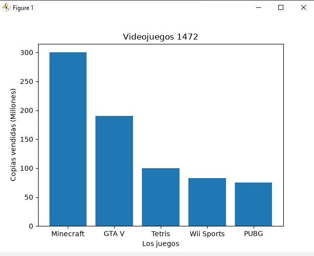
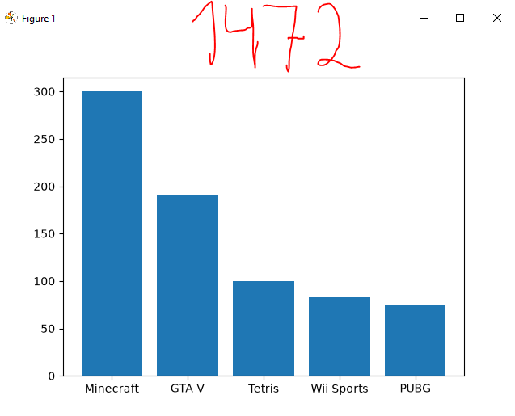
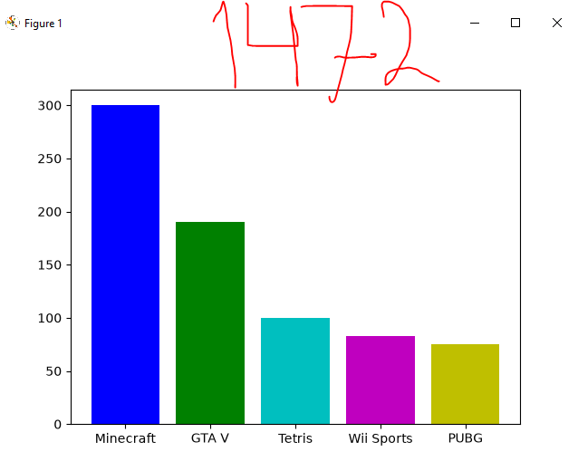
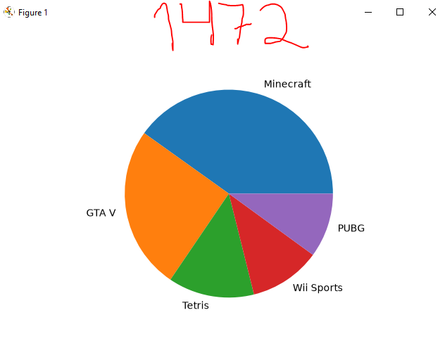

## dataframe o marco de datos 

## videojuegos a nivel mundial

## grafica lineal de videojuegos

## grafica puntual

## grafica de barras de videojuegos

## grafica de barras del mas grande al chico descendente

## coloreamosla grafica

## grafica de pastel o pie
